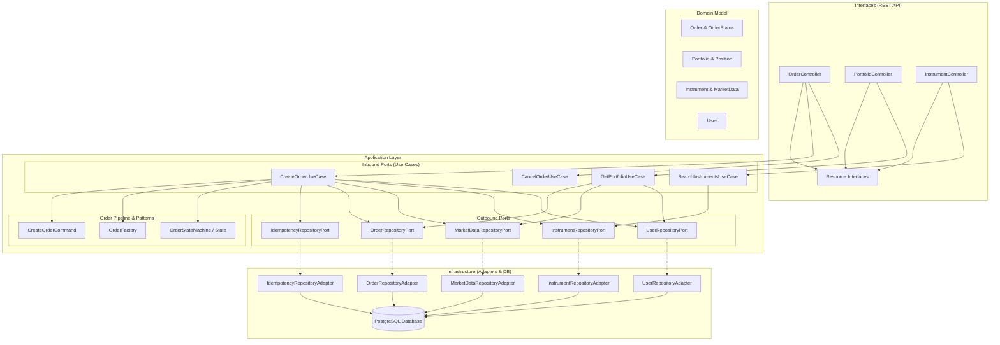

# Requirements

### Overview & Goals
El objetivo de este proyecto es implementar una API REST robusta, escalable y mantenible para el desafío técnico de **Cocos Capital**, utilizando **Java 25**, **Spring Boot 4.1.2** y **Arquitectura Hexagonal (Ports & Adapters)**.

La solución resolverá los requerimientos de consulta de portfolio valorizado en tiempo real, búsqueda de activos/instrumentos de mercado, y envío/cancelación de órdenes de compra y venta (`MARKET` y `LIMIT`), incorporando soporte transaccional de **idempotencia obligatoria** mediante el header `Idempotency-Key` (UUID), y aplicando patrones de diseño avanzados como **Command**, **State**, **Factory** y **Specification**.

---

### Scope

#### In Scope
1. **Consulta de Portfolio (`GET /v1/users/{userId}/portfolio`)**:
   - Valor total de la cuenta del usuario en pesos ($ ARS).
   - Pesos disponibles para operar (derivados de órdenes `FILLED` de `CASH_IN`, `CASH_OUT`, `BUY`, `SELL`).
   - Listado de activos en cartera con cantidad de acciones, valorización actual de mercado ($) y rendimiento porcentual (% diario y total).
2. **Búsqueda de Activos (`GET /v1/instruments?query=...`)**:
   - Búsqueda case-insensitive por ticker y/o nombre de instrumento.
   - Retorno de información del instrumento y su última cotización de mercado (`close`).
3. **Envío de Órdenes (`POST /v1/orders`)**:
   - Header obligatorio `Idempotency-Key: <UUID>` para garantizar idempotencia transaccional.
   - Soporte de órdenes `MARKET` (ejecución inmediata `FILLED` al último precio `close`) y `LIMIT` (ingresan como `NEW` con precio límite del usuario).
   - Soporte de envío por cantidad exacta de acciones (`size`) o por monto en pesos (`amount`), calculando `floor(amount / price)` (sin fracciones).
   - Validación de fondos disponibles en compras (`BUY`) y tenencia de acciones en ventas (`SELL`).
   - Si no cumple validación de fondos/tenencia, la orden se persiste en estado `REJECTED`.
4. **Cancelación de Órdenes (`DELETE /v1/orders/{orderId}`)**:
   - Permite cancelar únicamente órdenes con estado `NEW`, transicionando a `CANCELLED`.
5. **Calidad, Buenas Prácticas y Documentación**:
   - Manejo de errores global con `ProblemDetail` (RFC 7807).
   - Migraciones de base de datos con Flyway y compatibilidad con datos iniciales de `database.sql`.
   - Documentación Swagger/OpenAPI 3 interactiva.
   - Colección de pruebas de endpoints (Postman / HTTP Client).
   - Suite de tests unitarios y funcionales/integrados.

#### Out of Scope
- Autenticación y autorización JWT/OAuth2 (el desafío especifica explícitamente que no es requerida).
- Simulación de matching engine de mercado en tiempo real para ejecución diferida de órdenes `LIMIT` (las órdenes límite quedan en estado `NEW` esperando cancelación o ejecución externa no requerida).
- Fraccionamiento de acciones (solo se operan enteros positivos).

---

### User Stories

- **US-01 (Inversionista - Ver Portfolio)**: Como usuario de la plataforma, quiero consultar mi portfolio para conocer mi saldo disponible en pesos, el valor total de mi cuenta y el rendimiento de mis acciones.
- **US-02 (Inversionista - Buscar Activos)**: Como usuario, quiero buscar instrumentos financieros por ticker o nombre para conocer sus cotizaciones y decidir qué operar.
- **US-03 (Inversionista - Comprar/Vender a Mercado)**: Como usuario, quiero enviar órdenes `MARKET` por cantidad de acciones o monto en pesos para ejecutarlas instantáneamente al precio de cierre actual.
- **US-04 (Inversionista - Enviar Orden Límite)**: Como usuario, quiero enviar órdenes `LIMIT` fijando un precio máximo de compra o mínimo de venta para que queden registradas en estado `NEW`.
- **US-05 (Inversionista - Cancelar Orden)**: Como usuario, quiero poder cancelar órdenes pendientes (`NEW`) que aún no han sido ejecutadas.
- **US-06 (Sistema - Idempotencia)**: Como integrador/cliente API, quiero que al reenviar una orden con la misma `Idempotency-Key` el sistema no duplique la transacción y retorne la respuesta original.

---

### Functional Requirements

1. **Gestión de Idempotencia**:
   - Todo request a `POST /v1/orders` debe incluir el header `Idempotency-Key` con formato UUID válido.
   - Si el header no está presente o no es un UUID válido, la API retorna `400 Bad Request`.
   - Si la clave ya fue registrada previamente para el usuario, se retorna el resultado persistido originalmente sin reejecutar la lógica de negocio.
2. **Cálculo de Pesos y Tenencias**:
   - El saldo disponible de pesos se calcula sumando `CASH_IN` y `SELL` y restando `CASH_OUT` y `BUY` de órdenes en estado `FILLED`.
   - La tenencia de cada activo se calcula sumando `BUY` y restando `SELL` de órdenes en estado `FILLED`.
3. **Manejo de Estados de Órdenes**:
   - `NEW`: Orden límite válida registrada.
   - `FILLED`: Orden ejecutada inmediatamente (órdenes MARKET con fondos/acciones suficientes).
   - `REJECTED`: Orden rechazada por saldo insuficiente (compra) o tenencia insuficiente (venta).
   - `CANCELLED`: Orden previamente en estado `NEW` cancelada por el usuario.

---

### Non-Functional Requirements

- **Arquitectura Hexagonal Estricta**: Dominio puro e independiente, puertos de aplicación (inbound/outbound), configuración de beans explícita (`InboundBeansConfig`, `OutboundBeansConfig`), controllers que implementan interfaces Resource.
- **Java 25 & Records**: Modelos de dominio y DTOs modelados preferentemente como records inmutables.
- **Consistencia y Transaccionalidad**: Operaciones de persistencia atómicas con `@Transactional` en adaptadores y servicios.
- **Rendimiento**: Índices en PostgreSQL para optimizar consultas de agregación sobre la tabla `orders` y lecturas de `marketdata`.

# Technical Design

### Current Implementation
El repositorio actual es un proyecto esqueleto de Spring Boot 4.1.2 en Java 25 con la estructura de paquetes hexagonal inicial creada (`ar.com.cocos.challenge.*`), `pom.xml` con starters básicos (WebMvc, Data JPA, Flyway, PostgreSQL, Actuator) y la base de datos de referencia provista en `database.sql`.

---

### Key Decisions

1. **Idempotencia en la Capa de Aplicación (`IdempotencyPort`)**:
   - *Decisión*: Implementar el control de idempotencia como parte del caso de uso de creación de órdenes, persistiendo los registros en la tabla `idempotency_keys` en PostgreSQL.
   - *Razón*: Respeta la arquitectura hexagonal pura, permite atomicidad transaccional y evita dependencias ocultas o efectos colaterales en filtros HTTP que dificulten el testeo unitario.

2. **Patrones Command y State para Procesamiento de Órdenes**:
   - *Decisión*: Encapsular los datos de entrada en `CreateOrderCommand` y modelar el comportamiento y validación de órdenes mediante una máquina de estados `OrderState` (`NewOrderState`, `FilledOrderState`, `RejectedOrderState`, `CancelledOrderState`).
   - *Razón*: Desacopla las transiciones de estado, centraliza las reglas de negocio (fondos suficientes, validación de precio y tamaño) y permite extender fácilmente nuevos tipos de órdenes o estados futuros.

3. **Mantenimiento de IDs Numéricos (`Long`)**:
   - *Decisión*: Mantener claves primarias `Long` / `SERIAL` en las tablas existentes (`users`, `instruments`, `orders`, `marketdata`), utilizando `UUID` para la tabla `idempotency_keys` y encabezados REST.
   - *Razón*: Garantiza compatibilidad 100% con el script `database.sql` provisto para el challenge y optimiza el rendimiento en joins relacionales.

4. **Inyección de Dependencias Explícita vía `@Bean`**:
   - *Decisión*: Casos de uso instanciados exclusivamente en `InboundBeansConfig` y adaptadores en `OutboundBeansConfig` sin anotaciones `@Service` ni `@Component` en `domain/` ni `application/`.
   - *Razón*: Cumple estrictamente con las directrices de arquitectura hexagonal del skill Java.

5. **Estrategia Flyway por Perfiles (Demo vs Local)**:
   - *Decisión*: En el perfil default/demo (`application.yaml`), configurar Flyway con `baseline-on-migrate: true` y `baseline-version: 1` para saltar la ejecución del script `V1` sobre la base de datos preexistente y ejecutar únicamente a partir de `V2`. En el perfil local (`application-local.yaml`), desactivar baseline (`baseline-on-migrate: false`) para aprovisionar el esquema completo (`V1` + `V2`) desde cero.
   - *Razón*: Permite que la aplicación funcione de forma transparente tanto en el entorno de evaluación con la base precargada de `database.sql` como en entornos locales o CI/CD limpios, evitando errores de tablas duplicadas.

---

### Architecture Diagram



---

### Data Models / Contracts

#### 1. Domain Models (`domain/model/`)
```java
// domain/model/OrderSide.java
public enum OrderSide { BUY, SELL, CASH_IN, CASH_OUT }

// domain/model/OrderType.java
public enum OrderType { MARKET, LIMIT }

// domain/model/OrderStatus.java
public enum OrderStatus { NEW, FILLED, REJECTED, CANCELLED }

// domain/model/InstrumentType.java
public enum InstrumentType { ACCIONES, MONEDA, BONOS, CEDEARS }

// domain/model/Instrument.java
public record Instrument(Long id, String ticker, String name, InstrumentType type) {}

// domain/model/MarketData.java
public record MarketData(Long id, Long instrumentId, BigDecimal high, BigDecimal low, 
                          BigDecimal open, BigDecimal close, BigDecimal previousClose, LocalDate date) {}

// domain/model/Position.java
public record Position(
    Long instrumentId,
    String ticker,
    String name,
    Integer sharesCount,
    BigDecimal currentPrice,
    BigDecimal totalValue,
    BigDecimal dailyReturnPercentage,
    BigDecimal totalReturnPercentage
) {}

// domain/model/Portfolio.java
public record Portfolio(
    Long userId,
    String accountNumber,
    BigDecimal totalAccountValue,
    BigDecimal availableCash,
    List<Position> positions
) {}

// domain/model/Order.java
public class Order {
    private Long id;
    private Long instrumentId;
    private Long userId;
    private Integer size;
    private BigDecimal price;
    private OrderType type;
    private OrderSide side;
    private OrderStatus status;
    private Instant datetime;
    // Getters, restricted setters, and Builder
}

// domain/model/IdempotencyRecord.java
public record IdempotencyRecord(
    UUID key,
    Long userId,
    String requestHash,
    String responseBody,
    int statusCode,
    Instant createdAt
) {}
```

#### 2. DTOs & Resource Contracts (`interfaces/endpoint/`)

```java
// interfaces/endpoint/resources/OrderResource.java
@RequestMapping("")
@Tag(name = "Orders", description = "Endpoints para gestión de órdenes bursátiles")
public interface OrderResource {

    @PostMapping(value = "v{version}/orders", version = "1")
    @ResponseStatus(HttpStatus.CREATED)
    @Operation(summary = "Enviar una orden de compra o venta al mercado (Idempotente)")
    OrderResponse createOrder(
        @RequestHeader("Idempotency-Key") UUID idempotencyKey,
        @Valid @RequestBody CreateOrderRequest request
    );

    @DeleteMapping(value = "v{version}/orders/{orderId}", version = "1")
    @ResponseStatus(HttpStatus.OK)
    @Operation(summary = "Cancelar una orden pendiente en estado NEW")
    OrderResponse cancelOrder(@PathVariable Long orderId);
}

// interfaces/endpoint/resources/PortfolioResource.java
@RequestMapping("")
@Tag(name = "Portfolio", description = "Consulta de tenencias y saldos")
public interface PortfolioResource {

    @GetMapping(value = "v{version}/users/{userId}/portfolio", version = "1")
    @ResponseStatus(HttpStatus.OK)
    @Operation(summary = "Obtener el portfolio valorizado de un usuario")
    PortfolioResponse getPortfolio(@PathVariable Long userId);
}

// interfaces/endpoint/resources/InstrumentResource.java
@RequestMapping("")
@Tag(name = "Instruments", description = "Búsqueda y cotizaciones de instrumentos")
public interface InstrumentResource {

    @GetMapping(value = "v{version}/instruments", version = "1")
    @ResponseStatus(HttpStatus.OK)
    @Operation(summary = "Buscar activos por ticker y/o nombre")
    List<InstrumentResponse> searchInstruments(@RequestParam(required = false) String query);
}
```

#### 3. Request / Response Records
```java
// Request DTOs
public record CreateOrderRequest(
    @NotNull Long userId,
    @NotNull Long instrumentId,
    @NotNull OrderSide side,
    @NotNull OrderType type,
    Integer size,
    BigDecimal amount,
    BigDecimal price
) {}

// Response DTOs
public record OrderResponse(
    Long id,
    Long userId,
    Long instrumentId,
    String ticker,
    OrderSide side,
    OrderType type,
    OrderStatus status,
    Integer size,
    BigDecimal price,
    BigDecimal totalAmount,
    Instant datetime
) {}

public record PositionResponse(
    Long instrumentId,
    String ticker,
    String name,
    Integer size,
    BigDecimal currentPrice,
    BigDecimal totalMonetaryValue,
    BigDecimal dailyReturnPercentage,
    BigDecimal totalReturnPercentage
) {}

public record PortfolioResponse(
    Long userId,
    String accountNumber,
    BigDecimal totalAccountValue,
    BigDecimal availableCash,
    List<PositionResponse> positions
) {}

public record InstrumentResponse(
    Long id,
    String ticker,
    String name,
    InstrumentType type,
    BigDecimal lastPrice,
    BigDecimal previousClose,
    BigDecimal dailyVariationPercentage
) {}
```

---

### Design Patterns Applied

1. **Ports and Adapters (Hexagonal Architecture)**:
   - Separación estricta entre puertos inbound (`CreateOrderUseCase`, `GetPortfolioUseCase`, `SearchInstrumentsUseCase`), puertos outbound (`OrderRepositoryPort`, `IdempotencyRepositoryPort`, etc.), y adaptadores JPA / REST.
2. **Command Pattern**:
   - `CreateOrderCommand` encapsula la solicitud normalizada (con cantidad resuelta, precio resuelto, usuario e instrumento validados) antes de procesar la orden.
3. **State Pattern**:
   - Interfaz `OrderState` y estados concretos (`NewOrderState`, `FilledOrderState`, `RejectedOrderState`, `CancelledOrderState`) con métodos `execute()`, `reject()` y `cancel()` que gobiernan las transiciones válidas.
4. **Factory Pattern**:
   - `OrderFactory` centraliza la creación de entidades de orden y cálculo de tamaño si la orden se envía por monto en pesos (`floor(amount / price)`).
5. **Specification Pattern**:
   - `InstrumentSpecifications` con JPA Criteria API para consultas dinámicas compuestas (`ticker ILIKE %q% OR name ILIKE %q%`).
6. **Transactional Idempotency Store**:
   - Mecanismo en `IdempotencyRepositoryAdapter` para garantizar respuestas consistentes ante reintentos sin duplicación de efectos secundarios.

---

### Database Schema & Migrations

#### Estrategia por Perfiles Flyway
1. **Perfil Default / Demo (`application.yaml` - Sin Perfil Activo)**:
   - Configuración: `baseline-on-migrate: true`, `baseline-version: 1`, `baseline-description: "Initial demo database from database.sql"`.
   - Comportamiento: Marca la base de datos preexistente como versión 1 sin ejecutar `V1__initial_schema_and_seed.sql` y aplica únicamente las migraciones incrementales a partir de la versión 2 (`V2__add_idempotency_and_indexes.sql`).
2. **Perfil Local / Tests (`application-local.yaml` / `profile: local`)**:
   - Configuración: `baseline-on-migrate: false`.
   - Comportamiento: Ejecuta secuencialmente `V1__initial_schema_and_seed.sql` (creación de tablas y carga de datos iniciales) y luego `V2__add_idempotency_and_indexes.sql` para aprovisionar entornos desde cero de forma reproducible.

#### `V1__initial_schema_and_seed.sql`
- Tabla `users` (`id SERIAL PRIMARY KEY`, `email`, `accountNumber`).
- Tabla `instruments` (`id SERIAL PRIMARY KEY`, `ticker`, `name`, `type`).
- Tabla `orders` (`id SERIAL PRIMARY KEY`, `instrumentId`, `userId`, `size`, `price`, `type`, `side`, `status`, `datetime`).
- Tabla `marketdata` (`id SERIAL PRIMARY KEY`, `instrumentId`, `high`, `low`, `open`, `close`, `previousClose`, `date`).
- Carga de datos de seed inicial provistos en `database.sql`.

#### `V2__add_idempotency_and_indexes.sql`
```sql
CREATE TABLE IF NOT EXISTS idempotency_keys (
    key UUID PRIMARY KEY,
    user_id BIGINT NOT NULL,
    request_hash VARCHAR(64) NOT NULL,
    response_body TEXT NOT NULL,
    status_code INT NOT NULL,
    created_at TIMESTAMP NOT NULL DEFAULT CURRENT_TIMESTAMP,
    CONSTRAINT fk_idempotency_user FOREIGN KEY (user_id) REFERENCES users(id)
);

CREATE INDEX IF NOT EXISTS idx_orders_user_status ON orders(userId, status);
CREATE INDEX IF NOT EXISTS idx_orders_user_instrument ON orders(userId, instrumentId);
CREATE INDEX IF NOT EXISTS idx_marketdata_instrument_date ON marketdata(instrumentId, date DESC);
CREATE INDEX IF NOT EXISTS idx_instruments_ticker ON instruments(ticker);
CREATE INDEX IF NOT EXISTS idx_instruments_name ON instruments(name);
```

---

### File Structure

```
src/main/java/ar/com/cocos/challenge/
├── config/
│   ├── InboundBeansConfig.java
│   ├── OutboundBeansConfig.java
│   └── OpenApiConfig.java
├── application/
│   ├── command/
│   │   ├── CreateOrderCommand.java
│   │   └── CancelOrderCommand.java
│   ├── inbound/
│   │   ├── CreateOrderUseCase.java
│   │   ├── CancelOrderUseCase.java
│   │   ├── GetPortfolioUseCase.java
│   │   └── SearchInstrumentsUseCase.java
│   ├── outbound/
│   │   ├── UserRepositoryPort.java
│   │   ├── InstrumentRepositoryPort.java
│   │   ├── OrderRepositoryPort.java
│   │   ├── MarketDataRepositoryPort.java
│   │   └── IdempotencyRepositoryPort.java
│   ├── state/
│   │   ├── OrderState.java
│   │   ├── NewOrderState.java
│   │   ├── FilledOrderState.java
│   │   ├── RejectedOrderState.java
│   │   └── CancelledOrderState.java
│   └── usecases/
│       ├── CreateOrderUseCaseImpl.java
│       ├── CancelOrderUseCaseImpl.java
│       ├── GetPortfolioUseCaseImpl.java
│       └── SearchInstrumentsUseCaseImpl.java
├── domain/
│   ├── criteria/
│   │   └── InstrumentSearchCriteria.java
│   ├── exception/
│   │   ├── NotFoundException.java
│   │   ├── BadDataException.java
│   │   ├── InvalidOrderException.java
│   │   ├── InsufficientBalanceException.java
│   │   ├── InsufficientSharesException.java
│   │   └── IdempotencyConflictException.java
│   └── model/
│       ├── User.java
│       ├── Instrument.java
│       ├── InstrumentType.java
│       ├── Order.java
│       ├── OrderSide.java
│       ├── OrderType.java
│       ├── OrderStatus.java
│       ├── MarketData.java
│       ├── Position.java
│       ├── Portfolio.java
│       └── IdempotencyRecord.java
├── infrastructure/
│   └── database/
│       ├── adapter/
│       │   ├── UserRepositoryAdapter.java
│       │   ├── InstrumentRepositoryAdapter.java
│       │   ├── OrderRepositoryAdapter.java
│       │   ├── MarketDataRepositoryAdapter.java
│       │   └── IdempotencyRepositoryAdapter.java
│       ├── entities/
│       │   ├── UserEntity.java
│       │   ├── InstrumentEntity.java
│       │   ├── OrderEntity.java
│       │   ├── MarketDataEntity.java
│       │   └── IdempotencyEntity.java
│       ├── mappers/
│       │   ├── UserInfrastructureMapper.java
│       │   ├── InstrumentInfrastructureMapper.java
│       │   ├── OrderInfrastructureMapper.java
│       │   ├── MarketDataInfrastructureMapper.java
│       │   └── IdempotencyInfrastructureMapper.java
│       ├── repositories/
│       │   ├── UserJpaRepository.java
│       │   ├── InstrumentJpaRepository.java
│       │   ├── OrderJpaRepository.java
│       │   ├── MarketDataJpaRepository.java
│       │   └── IdempotencyJpaRepository.java
│       └── specifications/
│           └── InstrumentSpecifications.java
└── interfaces/
    └── endpoint/
        ├── controller/
        │   ├── OrderController.java
        │   ├── PortfolioController.java
        │   └── InstrumentController.java
        ├── exception/
        │   └── ExceptionsHandler.java
        ├── mapper/
        │   ├── OrderInterfaceMapper.java
        │   ├── PortfolioInterfaceMapper.java
        │   └── InstrumentInterfaceMapper.java
        ├── request/
        │   └── CreateOrderRequest.java
        ├── resources/
        │   ├── OrderResource.java
        │   ├── PortfolioResource.java
        │   └── InstrumentResource.java
        └── response/
            ├── OrderResponse.java
            ├── PortfolioResponse.java
            ├── PositionResponse.java
            └── InstrumentResponse.java
```

---

### Risks & Mitigations

| Riesgo Técnico / Negocio | Mitigación |
|---|---|
| Cálculo incorrecto de pesos disponibles por órdenes pendientes o canceladas | Solo considerar órdenes en estado `FILLED` para saldos y posiciones de mercado. |
| División por cero o monto insuficiente al enviar orden por `amount` | Validar que `amount >= price` antes de calcular `size = floor(amount / price)`; si es menor, rechazar inmediatamente. |
| Condición de carrera en envíos concurrentes con misma Idempotency-Key | Clave primaria sobre el campo `key` en tabla `idempotency_keys` para rechazar colisiones o retornar el resultado persistido. |
| Inconsistencia de precisión decimal en montos monetarios | Usar `BigDecimal` con escala y redondeo explícito (`RoundingMode.HALF_UP`) en todos los cálculos de dinero y rendimientos. |

# Testing

### Validation Approach
La estrategia de validación comprende tres niveles de verificación:
1. **Tests Unitarios de Dominio y Casos de Uso**: Pruebas con JUnit 5 y Mockito para las transiciones de la máquina de estados (`OrderState`), el cálculo del portfolio (`GetPortfolioUseCaseImpl`), las validaciones de fondos/tenencia y la idempotencia.
2. **Tests de Integración con Spring Boot**: `@SpringBootTest` con base de datos H2 en memoria / Testcontainers para validar el flujo REST de punta a punta, la persistencia JPA, las migraciones de Flyway y el comportamiento de endpoints.
3. **Colección de Endpoints (Postman / HTTP Client)**: Archivo `.http` / JSON de Postman con ejemplos ejecutables de cada caso de uso.

---

### Key Scenarios

#### 1. Consulta de Portfolio
- **Escenario**: `GET /v1/users/1/portfolio`
- **Resultado Esperado**: Retorna HTTP 200 con `totalAccountValue`, `availableCash` (calculado a partir de órdenes `FILLED` existentes en el seed), y la lista de `positions` con tickers, cantidad de acciones, valor actual y rendimiento.

#### 2. Búsqueda de Instrumentos
- **Escenario**: `GET /v1/instruments?query=YPF` o `GET /v1/instruments?query=galicia`
- **Resultado Esperado**: Retorna HTTP 200 con los instrumentos coincidentes (por ticker o nombre), incluyendo su último precio `close` y variación diaria.

#### 3. Envío de Orden MARKET Exitosa (BUY / SELL)
- **Escenario**: `POST /v1/orders` con `Idempotency-Key: <UUID>`, tipo `MARKET`, fondos/acciones suficientes.
- **Resultado Esperado**: Retorna HTTP 201 con estado `FILLED`, precio tomado del último `close` de `marketdata`, y actualización inmediata en el portfolio del usuario.

#### 4. Envío de Orden LIMIT (BUY / SELL)
- **Escenario**: `POST /v1/orders` con `Idempotency-Key: <UUID>`, tipo `LIMIT` y precio especificado por el usuario.
- **Resultado Esperado**: Retorna HTTP 201 con estado `NEW`. No afecta la cantidad de acciones ejecutadas en el portfolio.

#### 5. Rechazo de Orden por Saldo o Tenencia Insuficiente
- **Escenario**: `POST /v1/orders` con monto superior a los pesos disponibles (para BUY) o cantidad superior a las acciones en cartera (para SELL).
- **Resultado Esperado**: Retorna HTTP 201/200 con la orden grabada en estado `REJECTED`.

#### 6. Idempotencia de Órdenes
- **Escenario**: Enviar dos solicitudes idénticas a `POST /v1/orders` con la misma `Idempotency-Key`.
- **Resultado Esperado**: La primera solicitud procesa la orden; la segunda solicitud retorna exactamente la misma respuesta sin crear un segundo registro en `orders`.

#### 7. Cancelación de Orden NEW
- **Escenario**: `DELETE /v1/orders/{orderId}` sobre una orden en estado `NEW`.
- **Resultado Esperado**: Retorna HTTP 200 con la orden en estado `CANCELLED`.

---

### Edge Cases

- **Orden por monto menor al precio de una acción**: Si `amount < price`, el cálculo `floor(amount / price)` resulta en `0`, lo que genera rechazo inmediato (`REJECTED` o `400 Bad Request`).
- **Cancelación de orden en estado no cancelable**: Intentar cancelar una orden `FILLED`, `REJECTED` o ya `CANCELLED` debe retornar `422 Unprocessable Entity` o `400 Bad Request` con mensaje descriptivo vía `ProblemDetail`.
- **Header Idempotency-Key ausente o inválido**: Retornar `400 Bad Request` indicando que el header es obligatorio y debe ser un UUID válido.
- **Usuario o Instrumento inexistente**: Retornar `404 Not Found` vía `ProblemDetail`.

---

### Test Changes

- `src/test/java/ar/com/cocos/challenge/application/usecases/CreateOrderUseCaseTest.java`: Pruebas unitarias de creación de órdenes, máquina de estados, validaciones y mock de idempotencia.
- `src/test/java/ar/com/cocos/challenge/application/usecases/GetPortfolioUseCaseTest.java`: Pruebas de cálculo matemático de saldo disponible, tenencias y rendimiento.
- `src/test/java/ar/com/cocos/challenge/interfaces/endpoint/controller/OrderControllerIntegrationTest.java`: Pruebas funcionales e integradas de endpoints con `@AutoConfigureMockMvc`.
- `src/test/java/ar/com/cocos/challenge/interfaces/endpoint/controller/PortfolioControllerIntegrationTest.java`: Pruebas de integración del endpoint de portfolio.
- `src/test/java/ar/com/cocos/challenge/interfaces/endpoint/controller/InstrumentControllerIntegrationTest.java`: Pruebas de búsqueda de activos.

# Delivery Steps

### ✓ Step 1: Configuración de dependencias, base de datos y migraciones Flyway
El proyecto compila con todas las dependencias necesarias y la base de datos se inicializa automáticamente con el esquema relacional y datos de prueba según el perfil activo.

- Actualizar `pom.xml` agregando dependencias de MapStruct (`mapstruct`, `mapstruct-processor`), SpringDoc OpenAPI (`springdoc-openapi-starter-webmvc-ui`), y base de datos de pruebas H2.
- Configurar `application.yaml` para el perfil demo/default con `baseline-on-migrate: true` y `baseline-version: 1` para omitir la versión `V1` en bases preexistentes.
- Configurar `application-local.yaml` con `baseline-on-migrate: false` para ejecutar el aprovisionamiento completo (`V1` + `V2`) en entornos limpios.
- Crear script Flyway `V1__initial_schema_and_seed.sql` en `src/main/resources/db/migration/` con la creación de tablas (`users`, `instruments`, `orders`, `marketdata`) y carga de datos iniciales provistos en `database.sql`.
- Crear script Flyway `V2__add_idempotency_and_indexes.sql` para crear la tabla `idempotency_keys` (clave primaria UUID, hash de request, response payload y status) e índices para optimizar consultas de órdenes y market data.
- Configurar `OpenApiConfig.java` para documentación Swagger interactiva.

### ✓ Step 2: Entidades de dominio, adaptadores JPA y búsqueda de instrumentos
El módulo de instrumentos permite consultar y buscar activos mediante criterios dinámicos y mapeos bidireccionales limpios.

- Crear modelos de dominio `User`, `Instrument`, `InstrumentType` y `MarketData` como Java records inmutables.
- Crear entidades JPA `UserEntity`, `InstrumentEntity`, `MarketDataEntity` y repositorios Spring Data JPA con `JpaSpecificationExecutor`.
- Implementar `InstrumentSpecifications` para búsquedas insensibles a mayúsculas/minúsculas por ticker y nombre.
- Crear mappers MapStruct de infraestructura (`InstrumentInfrastructureMapper`, `MarketDataInfrastructureMapper`, `UserInfrastructureMapper`).
- Implementar adaptadores de persistencia (`InstrumentRepositoryAdapter`, `MarketDataRepositoryAdapter`, `UserRepositoryAdapter`) que implementan los puertos outbound.
- Implementar el caso de uso `SearchInstrumentsUseCaseImpl` y registrar los beans en `InboundBeansConfig` y `OutboundBeansConfig`.
- Implementar `InstrumentResource` y `InstrumentController` con DTOs `InstrumentResponse`.

### ✓ Step 3: Motor de cálculo de portfolio y balance de cuenta
El endpoint de portfolio calcula el saldo disponible en pesos, valor de mercado de cada activo y rendimientos en base al histórico de órdenes.

- Crear modelos de dominio `Portfolio`, `Position` y records auxiliares para balances y tenencias.
- Crear `OrderEntity` y `OrderJpaRepository` con métodos de consulta optimizados por usuario y estado `FILLED`.
- Implementar `OrderRepositoryAdapter` y mapper `OrderInfrastructureMapper` para el puerto `OrderRepositoryPort`.
- Crear `PortfolioCalculationService` (o caso de uso `GetPortfolioUseCaseImpl`) para orquestar:
  - Cálculo de pesos disponibles agregando movimientos de cash (`CASH_IN`, `CASH_OUT`, `BUY`, `SELL`).
  - Cálculo de tenencias de activos agregando compras y ventas ejecutadas.
  - Enriquecimiento con precios actuales (`close`) y previos (`previousClose`) desde `MarketDataRepositoryPort`.
  - Cálculo de valorización total monetaria y retorno porcentual.
- Registrar beans en `InboundBeansConfig` y `OutboundBeansConfig`.
- Crear `PortfolioResource`, `PortfolioController`, DTOs de response (`PortfolioResponse`, `PositionResponse`) y mapper `PortfolioInterfaceMapper`.

### ✓ Step 4: Pipeline de órdenes con patrones Command, State e Idempotencia
La API permite enviar órdenes MARKET y LIMIT con validación estricta de saldo/tenencia, transiciones de estado explícitas y garantía de idempotencia por header UUID.

- Crear enums y records de dominio: `OrderType` (MARKET, LIMIT), `OrderSide` (BUY, SELL, CASH_IN, CASH_OUT), `OrderStatus` (NEW, FILLED, REJECTED, CANCELLED) y `Order`.
- Implementar el patrón Command con `CreateOrderCommand` para desacoplar el request REST de la lógica de dominio.
- Implementar el patrón State con la jerarquía `OrderState` y estados concretos (`NewOrderState`, `FilledOrderState`, `RejectedOrderState`) gestionando la lógica de transición según tipo de orden y validación de fondos/acciones.
- Implementar `IdempotencyRepositoryPort`, entidad `IdempotencyEntity`, mapper y adaptador `IdempotencyRepositoryAdapter`.
- Implementar `CreateOrderUseCaseImpl`:
  - Validar y verificar la clave de idempotencia (`Idempotency-Key` UUID); si ya fue procesada, retornar la respuesta almacenada.
  - Resolver cantidad (`size`) o calcular a partir del monto total en pesos (`amount / price`).
  - Resolver precio (`close` para MARKET, precio provisto para LIMIT).
  - Validar disponibilidad de fondos (en compras) o tenencia de acciones (en ventas).
  - Aplicar máquina de estados para fijar estado (`FILLED`, `NEW`, `REJECTED`) y persistir la orden y el registro de idempotencia.
- Registrar beans en `InboundBeansConfig` y `OutboundBeansConfig`.
- Crear `OrderResource`, `OrderController`, DTOs (`CreateOrderRequest`, `OrderResponse`) y mappers.

### ✓ Step 5: Cancelación de órdenes, excepciones globales, OpenAPI y suite de pruebas
El sistema cuenta con cancelación de órdenes NEW, manejo uniforme de errores con ProblemDetail, colección de pruebas y suite de tests unitarios e integrados.

- Implementar `CancelOrderUseCaseImpl` para validar y cancelar órdenes en estado `NEW`, arrojando excepción de dominio si el estado no lo permite.
- Exponer endpoint de cancelación en `OrderResource` y `OrderController` (`DELETE /v1/orders/{orderId}`).
- Configurar `ExceptionsHandler` (`@ControllerAdvice`) implementando `ResponseEntityExceptionHandler` y formateando errores con `ProblemDetail` (400, 404, 409, 422, 500).
- Desarrollar suite de tests unitarios con Mockito para casos de uso, State Machine, cálculo de portfolio y validaciones de orden.
- Desarrollar tests de integración (`@SpringBootTest`) para verificar:
  - Flujo completo de orden MARKET ejecutada (`FILLED`).
  - Flujo de orden LIMIT pendiente (`NEW`).
  - Rechazo por saldo insuficiente o falta de acciones (`REJECTED`).
  - Idempotencia ante reenvío de solicitud con misma `Idempotency-Key`.
  - Cancelación de orden `NEW`.
- Generar colección de Postman/REST Client (archivo `.json` o `.http`) con ejemplos de ejecución de todos los endpoints.